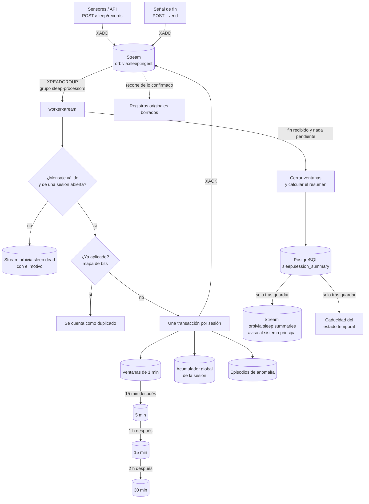

# Procesamiento incremental de datos de sueño

Módulo `sleep_stream` (`procesamiento/streaming-valores-continuos-sueno/`). Recibe los datos biométricos de cada astronauta mientras duerme, los reduce a agregados estadísticos a medida que llegan y, al terminar la sesión, deja un vector resumen sin volver a leer los registros originales.

Orbivia no diagnostica. Lo que aquí se llama anomalía es un valor estadísticamente raro respecto a la propia noche del astronauta, no un hallazgo clínico. Los rangos y umbrales de este documento son valores de diseño configurables, no umbrales médicos ni requisitos de NASA.

Uso práctico, endpoints y comandos: [README del módulo](../procesamiento/streaming-valores-continuos-sueno/README.md).

## 1. Flujo de datos



1. El sensor o la API encolan cada registro en un stream de Redis.
2. El servicio `worker-stream` lee por lotes con un grupo de consumidores.
3. Cada mensaje se valida. Lo que no se puede procesar va a un stream de rechazados con su motivo: nada se pierde en silencio y un mensaje malo no detiene a nadie.
4. Los registros de una sesión se aplican en una transacción que actualiza a la vez la ventana de 1 minuto, el acumulador global, las anomalías, el mapa de duplicados y la confirmación (`XACK`).
5. Las ventanas antiguas se funden en ventanas mayores y se borran. Los registros originales confirmados se recortan del stream.
6. La señal de fin viaja por el mismo stream, así que queda ordenada detrás de los registros.
7. Con el fin recibido y sin mensajes pendientes de esa sesión, se cierran las ventanas y se escribe el resumen.
8. El resumen se guarda en PostgreSQL. Solo entonces se avisa al sistema principal y se pone caducidad al estado temporal de Redis.

## 2. Qué hay en el repositorio y qué se reutiliza

- La infraestructura ya existía: Redis 7 (`broker`), PostgreSQL con pgvector (`db`), la API FastAPI y el contenedor `worker-stream`, que era un esqueleto. El módulo ocupa ese contenedor.
- Sigue el patrón del grafo social: paquete propio con sus tests, configuración por variables de entorno con prefijo, esquema propio en PostgreSQL creado al arrancar y guardado atómico.
- Sus endpoints se añaden a la API existente como un router, igual que hace el módulo de audio.
- El motor de colapso diario (`base-de-datos/vector-colapsado`) todavía no existe. El único vector de estado implementado es el catálogo del planificador de tareas (rama `feature/planificador`), que espera mediciones `{parameter, value, measured_at, source, confidence}`. La integración se describe en la sección 9.

## 3. Identificadores y mensajes

Todo dato va ligado a `astronaut_id` y `sleep_session_id`. Los identificadores son seudónimos, nunca nombres, y solo admiten letras, cifras, `.`, `_` y `-` (hasta 64 caracteres). No admiten `:` porque es el separador de las claves de Redis: así dos pares astronauta/sesión distintos nunca producen la misma clave.

Tres tipos de mensaje:

```json
{"type": "start", "astronaut_id": "ASTRO_001", "sleep_session_id": "SLEEP_2026_001",
 "start_timestamp": 1794672000, "sample_period_s": 1,
 "expected_metrics": ["heart_rate", "spo2"],
 "baselines": {"metrics": {"heart_rate": {"mean": 58, "sd": 4}},
               "vector": {"mean_heart_rate": {"mean": 56, "sd": 3}}}}

{"astronaut_id": "ASTRO_001", "sleep_session_id": "SLEEP_2026_001", "timestamp": 1794672060,
 "metrics": {"heart_rate": 58, "heart_rate_variability": 72, "spo2": 98,
             "respiratory_rate": 14, "skin_temperature": 33.8, "movement": 0.12},
 "units": {"heart_rate": "bpm"}}

{"type": "end", "astronaut_id": "ASTRO_001", "sleep_session_id": "SLEEP_2026_001",
 "end_timestamp": 1794700800}
```

En `start` solo son obligatorios los identificadores y `start_timestamp`. `sample_period_s` permite contar los registros que nunca llegaron. `expected_metrics` por defecto son las métricas conocidas. `end_timestamp` es opcional: sin él, el fin es el instante del último dato.

Los tiempos son epoch Unix en segundos. Un valor del orden de 10¹² se rechaza como "parece milisegundos" en vez de adivinarlo.

### Métricas conocidas

| Métrica | Unidad | Rango plausible del sensor | Histograma (percentiles) | Suelo de desviación |
|---|---|---|---|---|
| `heart_rate` | bpm | 20 – 250 | 30 – 130, bins de 1 | 1 |
| `heart_rate_variability` | ms | 0 – 400 | 0 – 200, bins de 2 | 2 |
| `spo2` | % | 50 – 100 | 80 – 100, bins de 0,5 | 0,5 |
| `respiratory_rate` | rpm | 2 – 70 | 5 – 35, bins de 0,5 | 0,5 |
| `skin_temperature` | degC | 20 – 45 | 28 – 40, bins de 0,1 | 0,1 |
| `movement` | a.u. | 0 – 10 | 0 – 2, bins de 0,02 | 0,02 |

El rango plausible separa un dato del sensor de un error de medida; no dice nada sobre la salud. La tabla se sustituye entera con un fichero JSON (`SLEEP_METRICS_FILE`).

Una métrica nueva que no esté en la tabla se acepta y se agrega igual (recuento, media, dispersión, extremos), sin rango ni percentiles, sin tocar nada más.

### Validación

Un mensaje mal formado se rechaza entero, con un código estable:

| Código | Causa |
|---|---|
| `bad_json`, `bad_structure`, `bad_type` | No es un objeto JSON válido o el tipo es desconocido |
| `bad_astronaut_id`, `bad_sleep_session_id` | Identificador ausente o con caracteres no admitidos |
| `bad_timestamp`, `timestamp_unit` | Tiempo no numérico, no positivo o en milisegundos |
| `bad_metrics`, `bad_units` | `metrics` vacío o no es un objeto |
| `unknown_session` | Registro de una sesión que no se ha iniciado |
| `before_start`, `beyond_max_session`, `after_end` | Tiempo fuera de la sesión (máximo 24 h) |
| `session_closed` | La sesión ya tiene resumen |
| `session_conflict` | Inicio repetido con otro `start_timestamp` |
| `processing_error` | Falló cinco veces al procesarse |

Dentro de un registro válido, cada métrica se clasifica por separado:

- **Válida:** entra en las estadísticas.
- **Ausente** (no viene o es `null`): se cuenta en `missing_count`. Nunca se sustituye por un valor.
- **Inválida** (texto, booleano, no finita, fuera del rango del sensor o con otra unidad): se cuenta en `invalid_count` con su motivo.

Una métrica mala no descarta las demás del mismo registro.

## 4. Claves de Redis

Prefijo por defecto `orbivia:sleep` (`SLEEP_PREFIX`).

| Clave | Tipo | Contenido | Caducidad |
|---|---|---|---|
| `{p}:ingest` | Stream | Registros y señales de inicio y fin | Se recorta lo confirmado |
| `{p}:dead` | Stream | Mensajes rechazados, con motivo e id de origen | Últimos 10 000 |
| `{p}:summaries` | Stream | Un aviso por resumen disponible | Últimos 1 000 |
| `{p}:session:{astro}:{sesión}` | Hash | Estado, contadores y acumulador global | 48 h tras completar |
| `{p}:agg:{astro}:{sesión}:L{k}` | Hash | Agregados del nivel k; campo = inicio de ventana | 48 h tras completar |
| `{p}:seen:{astro}:{sesión}` | Bitmap | Registros ya aplicados, 1 bit por segundo | 48 h tras completar |
| `{p}:anomalies:{astro}:{sesión}` | List | Episodios de anomalía cerrados | 48 h tras completar |
| `{p}:summary:{astro}:{sesión}` | String | Resumen final en JSON | 7 días tras completar |
| `{p}:index:{astro}` | ZSet | Sesiones de ese astronauta aún sin completar | — |
| `{p}:finalizing` | Set | Sesiones con fin recibido y sin resumen | — |
| `{p}:stats` | Hash | Recuento de rechazados por motivo | — |

Una sesión activa no tiene caducidad: el estado solo empieza a caducar cuando su resumen ya está en PostgreSQL.

Se eligieron las estructuras mínimas. Hay un único stream de ingesta en lugar de uno por astronauta: con tripulaciones de 4 a 6 personas es suficiente y más simple, y la separación la dan las claves de estado. No se usan Sorted Sets para las ventanas porque el inicio de ventana como campo de un Hash ya da acceso directo.

## 5. Agregación y colapso

### Qué guarda un agregado

Por cada métrica y ventana: recuento de válidos, media, suma de cuadrados centrada, mínimo, máximo, primera y última observación con su instante, recuento de ausentes y de inválidos, y un histograma disperso.

- **Media y varianza** se actualizan con el algoritmo de Welford, estable aunque los valores sean grandes. La desviación típica que se informa es la muestral (n − 1).
- **Percentiles** (5, 50 y 95) salen del histograma de bins fijos, interpolando dentro del bin. El error es de un bin como mucho. Se prefirió a un t-digest porque dos histogramas se funden sumando recuentos, de forma exacta y sin parámetros.
- **Tendencia** de cada métrica frente al tiempo: pendiente por mínimos cuadrados mantenida con la covarianza incremental tiempo-valor, a nivel de sesión.

### Fusión de agregados

Dos agregados con recuentos n₁, n₂, medias m₁, m₂ y sumas de cuadrados centradas S₁, S₂ se funden así:

```
n = n₁ + n₂
m = m₁ + (m₂ − m₁) · n₂ / n
S = S₁ + S₂ + (m₂ − m₁)² · n₁ · n₂ / n
```

El resultado es el mismo que si se hubieran visto todas las observaciones juntas. La media fundida pondera por recuento: no es la media de las medias. Mínimo, máximo, ausentes, inválidos e histograma se combinan de forma exacta; primera y última se eligen por su instante, no por el orden de llegada.

### Niveles y retención

| Nivel | Ventana | Se conserva | Agregados vivos en una noche de 8 h |
|---|---|---|---|
| 0 | 1 min | 15 min por detrás del último dato | ~20 |
| 1 | 5 min | 1 h | ~11 |
| 2 | 15 min | 2 h | ~5 |
| 3 | 30 min | Hasta el final de la sesión | hasta 16 |

Lo que supera la retención de un nivel se funde en el siguiente y se borra, en la misma transacción: nunca se borra una ventana antes de que su fusión esté escrita. En el benchmark el máximo fue de 47 agregados vivos por sesión. Al finalizar todo se funde en ventanas de 30 minutos: 16 para una noche de 8 horas.

Los tamaños (`SLEEP_LEVELS_S`) y las retenciones (`SLEEP_RETAIN_S`) son configurables. Cada tamaño debe ser múltiplo del anterior y las retenciones no pueden decrecer.

Además de las ventanas hay un acumulador global por métrica que se actualiza con cada registro. Las métricas finales salen de él, así que finalizar no recorre nada. Al cerrar se comprueba que la fusión de todas las ventanas coincide con ese acumulador (`aggregates_consistent`).

### Desorden, retrasos y duplicados

- **Fuera de orden:** las estadísticas no dependen del orden de llegada.
- **Con retraso:** un registro cuyo minuto ya se colapsó se incorpora al agregado más fino que todavía cubre su instante. La incorporación es exacta para recuento, media, varianza, extremos e histograma. Se cuenta en `late_into_coarser_window`.
- **Duplicados:** un registro se identifica por astronauta, sesión e instante, con resolución de 1 segundo (`SLEEP_DEDUP_RESOLUTION_S`). Un mapa de bits recuerda los ya aplicados y ocupa 3,6 KB por noche de 8 horas. Sin él no se podría detectar un duplicado de un registro cuyos originales ya se borraron. Hace que reenviar datos sea inocuo.

## 6. Anomalías

La compresión no debe borrar un pico solo porque la media de su ventana sea normal. Por eso cada valor se puntúa antes de agregarlo y lo anómalo se guarda aparte.

Dos métodos, ambos estadísticos:

- **`ewma_zscore`:** distancia del valor a una media y varianza exponenciales (semivida de 10 minutos, olvido según el tiempo transcurrido). Se usa una referencia local porque las constantes derivan durante la noche y la media de toda la sesión no sería buena referencia. Es anomalía si supera 4 desviaciones.
- **`baseline_zscore`:** distancia a la línea base individual, si se aportó al iniciar la sesión.

Detalles que importan:

- Los primeros 10 minutos son de calentamiento: se promedia sin olvido y `ewma_zscore` no puntúa. La línea base, si existe, sí.
- Un valor anómalo entra en la referencia recortado al umbral. Así un cambio de nivel sostenido acaba siendo la nueva referencia, pero un pico no la ensancha ni oculta los siguientes.
- La desviación tiene un suelo igual a la resolución del sensor, para que una señal cuantizada y estable no produzca puntuaciones enormes.
- Las muestras anómalas seguidas (a menos de 2 minutos) forman un solo episodio.

Cada episodio guarda: métrica y unidad, método y umbral, inicio y fin, número de muestras, valor e instante del pico, puntuación del pico, la referencia usada (media y desviación) y el contexto de su ventana de 1 minuto tal como estaba justo antes (recuento, media, desviación, mínimo, máximo).

Se guardan hasta 200 episodios por sesión; los que excedan se cuentan en `anomalies_dropped`. Además, el mínimo y el máximo de cada ventana se conservan siempre de forma exacta.

## 7. Garantías de procesamiento

**Atomicidad.** Cada lote de una sesión se confirma con `WATCH` sobre la clave de la sesión y `MULTI/EXEC`. La transacción escribe el estado, las ventanas tocadas, los bits de duplicados, las anomalías, los rechazados y el `XACK`. Un mensaje queda aplicado y confirmado, o ninguna de las dos cosas.

**Concurrencia.** Si dos consumidores tocan la misma sesión a la vez, uno pierde la transacción y reintenta con el estado nuevo. Sesiones distintas no se bloquean entre sí.

**Caída del consumidor.** Lo leído y no confirmado queda pendiente en el grupo. Al reiniciar, el consumidor retoma primero lo suyo; pasado medio minuto, cualquier otro lo reclama. Un mensaje que falla cinco veces va a rechazados como `processing_error`.

**Idempotencia.** Reprocesar un mensaje ya aplicado no cambia nada (lo frena el mapa de bits). Repetir el inicio con los mismos datos no cambia nada. Repetir el fin tampoco.

**Cálculo fuera de Redis.** La estadística se calcula en Python y no en scripts Lua, porque Redis Lua formatea los decimales con 14 cifras y perdería precisión al guardar los acumuladores.

### Finalización

1. La señal de fin llega por el stream. La sesión pasa a `finalizing` y sigue aceptando registros atrasados hasta `end_timestamp`.
2. Cuando no queda ningún mensaje pendiente de esa sesión anterior a la señal, se cierran las ventanas, se puntúan los últimos minutos, se cierran los episodios abiertos y se escribe el resumen en Redis. La sesión pasa a `sealed` y ya no admite datos.
3. El resumen se guarda en PostgreSQL con `ON CONFLICT DO NOTHING`: si ya había uno, se conserva el primero.
4. Solo entonces, en una transacción, la sesión pasa a `completed`, se publica el aviso y se pone caducidad al estado temporal.

Cada paso se puede repetir sin efectos. Si PostgreSQL no responde, la sesión se queda en `sealed`, sin caducidad y sin aviso, y se reintenta. El resumen no es visible desde fuera hasta que está guardado de forma duradera.

El trabajo de cerrar está acotado por el número de ventanas vivas (unas decenas), no por el de registros.

### Persistencia de Redis

Redis no es el almacenamiento permanente: el resumen final vive en PostgreSQL (`sleep.session_summary`, clave primaria astronauta + sesión).

Mientras la sesión está abierta, su estado depende de la persistencia de Redis, configurada en `docker-compose.yml`:

- `appendonly yes` con `appendfsync everysec`: el registro de operaciones se sincroniza a disco cada segundo, en `volumenes/redis`.
- `maxmemory-policy noeviction`: Redis nunca descarta claves por falta de memoria; si se llenara, rechazaría escrituras.

Con `everysec`, un apagado brusco puede perder hasta un segundo de operaciones. Como estado y confirmación van en la misma transacción, lo que se pierde se pierde de forma coherente: los mensajes vuelven a estar pendientes y se reprocesan. Lo único irrecuperable serían registros encolados en ese último segundo, y un sensor puede reenviarlos sin riesgo gracias a la deduplicación. Si esa ventana no es aceptable, `appendfsync always` la elimina a costa de rendimiento.

## 8. Resumen y vector de sueño

El resumen separa tres cosas:

1. `metrics`: estadísticas de cada métrica biométrica en su unidad original.
2. `sleep_summary_vector`: las dimensiones del vector, en unidades físicas.
3. `normalized_vector`: las mismas dimensiones normalizadas, solo donde hay una transformación definida.

### Dimensiones

El orden lo da `vector_spec`. Para obtener el vector como lista se usa `integration.vector_values(summary)`; el orden de las claves del objeto no es fiable, porque PostgreSQL no lo conserva.

| # | Dimensión | Unidad | Significado |
|---|---|---|---|
| 1 | `time_in_bed_h` | h | Duración de la sesión: fin menos inicio |
| 2 | `estimated_sleep_h` | h | Minutos sin actividad, por actigrafía |
| 3 | `sleep_efficiency` | 0–1 | Minutos sin actividad entre minutos con dato de movimiento |
| 4 | `sleep_fragmentation` | episodios/h | Rachas de actividad por hora con dato de movimiento |
| 5 | `mean_heart_rate` | bpm | Media de la frecuencia cardíaca |
| 6 | `mean_hrv` | ms | Media de la variabilidad cardíaca |
| 7 | `mean_spo2` | % | Media de la saturación de oxígeno |
| 8 | `mean_respiratory_rate` | rpm | Media de la frecuencia respiratoria |
| 9 | `mean_skin_temperature` | degC | Media de la temperatura cutánea |
| 10 | `movement_level` | a.u. | Media del movimiento |
| 11 | `hrv_trend` | ms/h | Pendiente de la variabilidad cardíaca durante la sesión |
| 12 | `measurement_completeness` | 0–1 | Valores válidos entre valores esperados, media de las métricas esperadas |

Respecto a la estructura inicial propuesta:

- `sleep_duration` se ha desdoblado en `time_in_bed_h` y `estimated_sleep_h`. Sin estadios de sueño no se mide el sueño, solo el tiempo en cama y la quietud.
- `sleep_efficiency` se añade porque es lo que el catálogo del planificador llama `sleep_quality`.

### Actigrafía

Cada minuto se clasifica como activo si la media de `movement` supera `SLEEP_ACTIVITY_THRESHOLD` (0,3 por defecto), quieto si no la supera, o sin dato si no hubo movimiento medido. Un minuto sin dato no cuenta como dormido. Una racha es una secuencia de minutos activos seguidos. El umbral depende del sensor y hay que calibrarlo; no es un criterio médico.

### Normalización

No se normaliza por defecto. Cada dimensión lleva su estado:

| Caso | `value` | `status` | `method` |
|---|---|---|---|
| Hay línea base individual para esa dimensión | (valor − media) / desviación | `known` | `baseline_z` |
| Es una fracción 0–1 (`sleep_efficiency`, `measurement_completeness`) | El propio valor | `known` | `identity` |
| No hay línea base | `null` | `no_baseline` | `baseline_z` |
| La dimensión no se pudo calcular | `null` | `missing` | — |

La puntuación z no se recorta ni se interpreta: no se asume que una frecuencia cardíaca más baja o una variabilidad más alta sean mejores. La referencia es la línea base de cada astronauta, que es el criterio general de Orbivia, y la aporta quien inicia la sesión. No se inventan rangos poblacionales. Es la misma semántica que el planificador (`known` / `no_baseline` / ausente).

### Valores ausentes

- Una dimensión que no se puede calcular vale `null`, nunca 0.
- `measurement_completeness` usa como denominador los registros que debieron llegar si se declaró `sample_period_s`, y los recibidos si no.
- `session_metadata` separa registros que nunca llegaron (`missing_observations`), valores ausentes dentro de registros (`missing_values`) e inválidos (`invalid_values`, con sus motivos).

### Contenido del resumen

`astronaut_id`, `sleep_session_id`, `sleep_summary_vector`, `vector_spec`, `normalized_vector`, `metrics`, `sleep` (actigrafía), `timeline` (ventanas finales de 30 minutos), `anomalies` y `session_metadata` (inicio, fin, observaciones, duplicados, rechazos, coherencia de agregados, versión de configuración y estado). Ocupa unos 26 KB en JSON para una noche de 8 horas.

## 9. Integración con Orbivia

**API.** Router `/sleep` incluido en la API existente. La API valida y encola; el trabajo lo hace `worker-stream`.

**Aviso.** Cada resumen completado publica una entrada en el stream `orbivia:sleep:summaries` con astronauta, sesión, inicio y fin. El motor diario puede leerlo con su propio cursor o grupo y pedir el resumen por la API o leerlo de PostgreSQL.

**Planificador.** `GET /sleep/sessions/{astronauta}/{sesión}/measurements` devuelve mediciones con el formato exacto que el planificador ya acepta. El módulo de sueño no importa su código.

| Parámetro del planificador | Origen | Nota |
|---|---|---|
| `sleep_duration_h` | `estimated_sleep_h` | Sueño estimado por actigrafía |
| `sleep_quality` | `sleep_efficiency` × 100 | El catálogo lo define como eficiencia del sueño en % |

- `confidence` es la fracción de minutos de la sesión con dato de movimiento.
- `measured_at` es el fin de la sesión en segundos de misión: epoch menos `SLEEP_MISSION_EPOCH_S`.
- No se emiten `spo2` ni `resting_hr`. En el catálogo son medidas diurnas (ping diario y reposo despierto) y sus valores nocturnos no son equivalentes.

## 10. Pruebas

108 tests (`pytest`), con Redis y PostgreSQL reales. Usan la base 15 de Redis y un prefijo único por test, y borran solo sus claves.

| Fichero | Qué cubre |
|---|---|
| `test_stats.py` | Welford frente al cálculo directo, fusión, percentiles, tendencia, referencia exponencial |
| `test_records.py` | Validación de mensajes, clasificación de métricas, configuración |
| `test_engine.py` | Ventanas, colapso, desorden, duplicados, ausentes, anomalías, actigrafía, vector |
| `test_pipeline.py` | Flujo completo sobre Redis, concurrencia y recuperación |
| `test_api.py` | Endpoints y contrato con el planificador |
| `test_store.py` | Almacén en memoria y en PostgreSQL |

Escenarios multiusuario y de recuperación cubiertos:

| Escenario | Resultado comprobado |
|---|---|
| Un astronauta | Estadísticas iguales al cálculo exacto; stream vacío al terminar |
| Cinco astronautas a la vez, con tres consumidores | Cada resumen coincide con sus propios datos; ninguno se mezcla |
| Finales en momentos distintos | Uno tiene resumen mientras el otro sigue activo |
| Dos sesiones del mismo astronauta, entrelazadas | Resúmenes independientes; historial con ambas |
| Registros desordenados | Mismas estadísticas, primera y última incluidas |
| Duplicados, también de minutos ya colapsados | Se cuentan y no alteran nada |
| Consumidor que muere con mensajes leídos | No se finaliza hasta reclamarlos; no se pierde ninguno |
| Corte de conexión al confirmar una transacción | Ni pérdida ni doble conteo; resultado idéntico |
| Reinicio del procesador | Continúa desde el estado de Redis; resultado idéntico |
| Seis hilos finalizando cuatro sesiones | Un resumen y un aviso por sesión |
| PostgreSQL caído al finalizar | Sin aviso ni caducidad hasta que se guarda |

### Reinicio real de Redis

Con `python -m sleep_stream.recovery_check` y contenedores reales (Redis 7.4 con AOF `everysec`, PostgreSQL 16 y el worker), el 14 de noviembre de 2026:

- 5 astronautas, 8 horas a 1 registro por segundo, unos 142 500 registros.
- Se encola la primera mitad con el worker en pausa, se reanuda y, 1,2 segundos después, con unos 14 000 registros aplicados por astronauta y el resto pendiente, se interrumpe Redis.
- Después se reenvían los últimos 2 000 registros de cada astronauta, se envía la segunda mitad y la señal de fin.

| Interrupción | Registros en el resumen | Duplicados ignorados | Recuentos y extremos | Error relativo máximo (media, desviación) | Pendientes / rechazados |
|---|---|---|---|---|---|
| `docker restart` (apagado ordenado) | Todos, en los 5 | 2 000 por astronauta | Exactos | 1,2 × 10⁻¹² | 0 / 0 |
| `docker kill` (SIGKILL) y arranque | Todos, en los 5 | 2 000 por astronauta | Exactos | 4,3 × 10⁻¹³ | 0 / 0 |

El worker registró el corte, esperó 5 segundos, reconectó y siguió.

## 11. Benchmark

`python -m sleep_stream.benchmark`. Los mismos registros sintéticos pasan por dos escenarios sobre el mismo Redis:

- **A, sin agregación:** cada registro se guarda en un stream por sesión; el resumen se calcula al final leyendo y recorriendo todos.
- **B, incremental:** el flujo real del módulo.

Condiciones: 14 de noviembre de 2026, Docker Desktop en macOS (aarch64), Python 3.12.16, Redis 7.4.12, PostgreSQL 16, un solo proceso y un solo consumidor, 5 astronautas, 8 horas, semilla 42. La memoria de Redis se mide clave a clave con `MEMORY USAGE` (`SAMPLES 0`). En B los datos se envían en bloques de 10 minutos y se procesan a continuación. Resultados completos en `procesamiento/streaming-valores-continuos-sueno/benchmarks/`.

### A 1 registro por segundo (142 564 registros)

| Medida | A: sin agregación | B: incremental |
|---|---|---|
| Registros originales en Redis al final de la noche | 142 564 | 0 |
| Agregados por sesión | — | 47 como máximo; 16 al finalizar |
| Memoria de Redis al final de la noche | 41,8 MB | 0,38 MB |
| Memoria de Redis con 10 min sin procesar | — | 1,25 MB |
| Memoria de Redis tras finalizar, hasta que caduca | 41,8 MB | 0,35 MB |
| Tiempo de proceso por registro | 5,2 µs (solo encolar) | 6,3 µs encolar + 26,1 µs procesar |
| Tiempo de finalización por sesión | 1,44 s | 0,033 s (incluye guardar en PostgreSQL) |
| Memoria de Python al finalizar (pico) | 59,4 MB | 0,37 MB |

- Redis usa unas **110 veces menos** memoria.
- Finalizar es unas **44 veces más rápido** y no carga los registros en memoria.
- El coste es de unos 27 µs más por registro durante la noche: un consumidor procesa unos 38 000 registros por segundo.

### A 1 registro por minuto (2 371 registros)

| Medida | A: sin agregación | B: incremental |
|---|---|---|
| Memoria de Redis al final de la noche | 0,74 MB | 0,29 MB |
| Tiempo de proceso por registro | 7,0 µs (solo encolar) | 8,4 µs encolar + 197 µs procesar |
| Tiempo de finalización por sesión | 0,023 s | 0,028 s |

Con tan pocos datos la ventaja baja a **2,6 veces** en memoria y finalizar **no es más rápido**. El coste fijo por sesión (estado, histogramas, resumen) pesa más que los registros. La agregación incremental compensa cuando el muestreo es denso.

### Precisión

Frente al cálculo exacto del escenario A, en ambas cadencias:

| Magnitud | Resultado |
|---|---|
| Recuentos, mínimo y máximo | Exactos |
| Media | Error relativo máximo 8 × 10⁻¹⁵ |
| Desviación típica | Error relativo máximo 5 × 10⁻¹³ |
| Tendencia | Error relativo máximo 1 × 10⁻⁹ |
| Percentiles 5, 50 y 95 | Error máximo de 0,48 bins |
| Actigrafía (minutos puntuados, activos y rachas) | Idéntica |

### Qué se pierde

La resolución temporal pasa de 1 segundo a 30 minutos: de 28 512 puntos por métrica a 16. La forma de la noche se conserva solo en parte. Fracción de la varianza de cada métrica que explican las 16 medias de 30 minutos (a 1 Hz):

| Métrica | Varianza explicada |
|---|---|
| `skin_temperature` | 93 % |
| `respiratory_rate` | 48 % |
| `heart_rate` | 32 % |
| `heart_rate_variability` | 27 % |
| `movement` | 7 % |
| `spo2` | 0,06 % |

Las métricas con deriva lenta se reconstruyen bien; las dominadas por ruido rápido o por eventos breves, no. Eso es lo que la compresión descarta. A cambio se conservan, de forma exacta, el mínimo y el máximo de cada ventana y los episodios anómalos con su instante: los 15 picos de frecuencia cardíaca inyectados aparecen como anomalías (15 de 15), con unos 14 episodios por sesión contando las rachas de movimiento.

Los datos son sintéticos. Estos porcentajes describen el generador, no la fisiología real.

## 12. Limitaciones

- **Sin estadios de sueño.** El sueño se estima por quietud. El umbral de movimiento es un valor de diseño que hay que calibrar con el sensor real.
- **Retrasos de más de 15 minutos de datos.** El registro cuenta en todas las estadísticas, pero su minuto queda sin clasificar en la actigrafía.
- **Las anomalías dependen del orden de llegada.** Un dato atrasado se puntúa contra la referencia actual y no la actualiza. Las estadísticas no dependen del orden.
- **Calentamiento.** `ewma_zscore` no detecta nada en los primeros 10 minutos de la sesión.
- **Resolución de duplicados de 1 segundo.** Dos registros distintos del mismo astronauta en el mismo segundo se tratan como uno; para muestreos más rápidos hay que bajar `SLEEP_DEDUP_RESOLUTION_S`.
- **Percentiles aproximados.** Un bin de error, y los valores válidos fuera del rango del histograma caen en el primer o el último bin.
- **Sin conversión de unidades.** Una unidad distinta de la esperada invalida el valor; no se convierte.
- **Sesiones abandonadas.** Una sesión sin señal de fin no caduca ni se cierra sola. Hay que finalizarla; sin `end_timestamp` se cierra en su último dato.
- **Sesión de 24 horas como máximo.**
- **Pérdida de hasta un segundo** de registros encolados ante un apagado brusco de Redis con `appendfsync everysec` (sección 7).
- **Espera conservadora al finalizar.** Con 200 o más mensajes pendientes anteriores al fin, se espera aunque sean de otros astronautas.
- **API sin autenticación.** Igual que el resto de la API en `develop`. Son datos de salud: debe alinearse con el esquema de acceso por rol antes de exponerla.
- **Contrato con el planificador sin prueba cruzada.** El planificador vive en otra rama; aquí solo se comprueba el formato de la medición.
- **Datos sintéticos.** No se han usado datos reales de astronautas.
