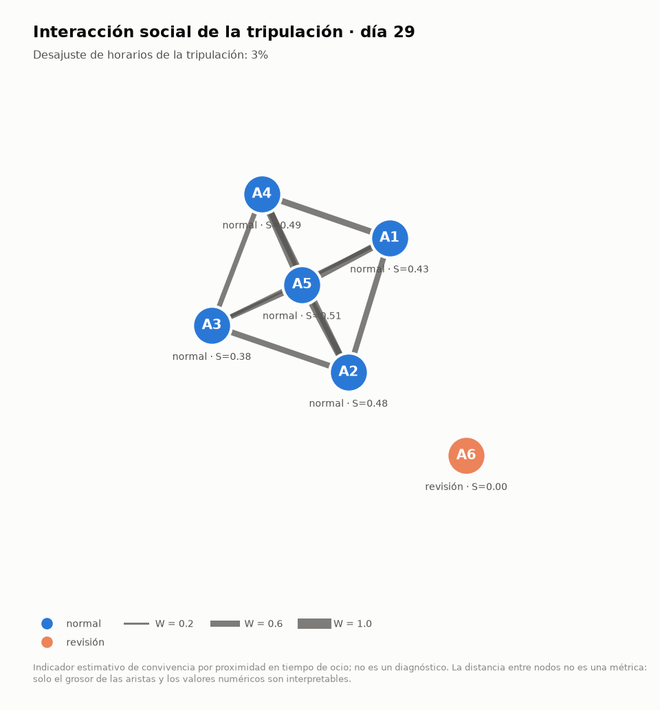

# Grafo social de la tripulación — documento de diseño

Estado: propuesta de la Fase 1, pendiente de aprobación. Nada de esto está implementado todavía.

Módulo de ORBIVIA que estima, a partir de las posiciones de los astronautas, cuánto tiempo de ocio pasan juntos, y produce una matriz y un grafo diarios. Sobre ese grafo trabajan dos módulos independientes: `IsolationAnalyzer` (indicadores de integración social) y `CollaborationRecommender` (propuestas de actividades conjuntas voluntarias). Es un **indicador para personal autorizado en Tierra, no un diagnóstico**.

## 1. Resumen de decisiones

| Tema | Decisión | Cambia respecto a la propuesta inicial |
|---|---|---|
| Normalización | `R_solape = I_ij / O_obs_ij` alimenta W. `R_ocio` (la fórmula original) se guarda también | Sí |
| Desajuste de horarios | Indicador aparte: `A_ij = O_ij / H(T_i, T_j)`. No entra en W | Nuevo |
| Tiempo de ocio | Por conjuntos de intervalos, no por resta | Sí (equivalente si no hay solapes) |
| Función de peso | Exponencial saturante, `κ = 0.3`. Intercambiable; lineal como alternativa | No (se fija κ) |
| Día | Corte fijo en hora de misión, configurable, por defecto 04:00 | — |
| Histéresis | Entrada 2.0 m, salida 2.5 m, permanencia mínima 60 s, hueco máximo 60 s | — |
| Huecos | Nunca se interpola: el hueco no suma interacción ni tiempo observado | — |
| Aislamiento | `IsolationAnalyzer`: cuatro indicadores individuales frente a la línea base propia, una comprobación frente a la tripulación y estructura de comunidades. Nunca una sola métrica | Sí |
| Recomendación | `CollaborationRecommender`: parejas o tríos para actividades voluntarias en ocio común, con justificación numérica y revisión humana | Nuevo |
| Grafo de análisis | Comunidades, centralidad y recomendaciones usan el grafo suavizado de 7 días, no el de un solo día | Nuevo |
| Layout | `spring_layout` con semilla fija e inicio en las posiciones del día anterior; circular fijo como alternativa | — |
| Reloj | El servicio avanza con los timestamps de los datos, no con el reloj del contenedor | Nuevo |

## 2. Supuestos (por confirmar)

Son hipótesis de hackathon acordadas con Eduardo; todas son configurables.

- **Entrada:** posiciones 3D (metros) de todos los astronautas, en instantáneas periódicas. El módulo calcula las distancias por pareja. La frecuencia de muestreo es libre: las duraciones salen de los timestamps.
- **Horarios:** sueño y trabajo fijos por astronauta, con una variación aleatoria diaria que genera el simulador. El ocio es lo que queda.
- **Persistencia:** solo el resultado diario. Las muestras de posición y sus timestamps no se guardan; los timestamps se usan en memoria para calcular duraciones.
- **Transporte y almacenamiento:** Redis Streams y PostgreSQL, que ya existen en el `docker-compose.yml`. El contrato de la sección 12 lo define este módulo y se puede cambiar.
- **Demo:** el simulador acelera el tiempo para producir varios días de histórico en minutos.

## 3. Definiciones

Para un día `D` (ventana de 24 h entre dos cortes) y cada astronauta `i`:

- `L_i`: conjunto de instantes de `D` en que `i` está en ocio. `T_ocio_i = |L_i|`.
- `O_ij = |L_i ∩ L_j|`: ocio simultáneo de la pareja.
- `O_obs_ij`: parte de `O_ij` en la que hay datos válidos de posición de los dos.
- `I_ij`: tiempo de interacción, contado solo dentro del ocio simultáneo observado.
- `c_ij = O_obs_ij / O_ij`: cobertura de datos de la pareja.

Por construcción `0 ≤ I_ij ≤ O_obs_ij ≤ O_ij ≤ min(T_ocio_i, T_ocio_j)`.

## 4. Revisión del modelo

### a) Normalización: por ocio individual o por solape

La fórmula original se puede reescribir:

```
R_ocio_ij = (I/T_i + I/T_j) / 2 = I / H(T_i, T_j)      H = media armónica = 2·T_i·T_j / (T_i + T_j)
```

Y se descompone en dos factores:

```
R_ocio_ij = (I_ij / O_ij) · (O_ij / H)  =  R_solape_ij · A_ij
```

- `R_solape`: de todo el tiempo en que podían coincidir, qué fracción pasaron juntos.
- `A_ij ∈ [0, 1]`: cuánto coinciden sus ocios. Es justo el desajuste de horarios.

Así que `R_ocio` es el producto de las dos cosas que se quieren medir por separado. Dos astronautas con turnos opuestos saldrían "poco relacionados" aunque pasen juntos todo el rato que pueden.

**Decisión:** W se calcula con `R_solape`, usando el solape observado en el denominador (`I_ij / O_obs_ij`), de modo que la falta de datos tampoco baje el valor. `A_ij` se guarda como indicador separado. `R_ocio` se guarda también, porque es barato y permite comparar.

Limitación de `R_solape`: una pareja con 20 minutos de solape que los pasa juntos obtiene 1. Es "intenso pero breve". Por eso hace falta un umbral mínimo de solape (apartado b) y una métrica en tiempo absoluto (`C_i`, apartado f).

Alternativa descartada: normalizar solo por `T_ocio_i`. Confunde afinidad con horarios.

### b) Cotas y ruido

**`R_ocio ∈ [0, 1]`.** Como `I ≤ O ≤ min(T_i, T_j)`, se cumple `I/T_i ≤ 1` e `I/T_j ≤ 1`, y la media de dos números en [0, 1] está en [0, 1]. Vale 1 solo si `T_i = T_j = I`.

**`R_solape ∈ [0, 1]`.** Directo de `0 ≤ I ≤ O_obs`.

Las dos demostraciones dependen de condiciones que la implementación debe garantizar:

1. La interacción se recorta al ocio simultáneo. La histéresis y la tolerancia de huecos no pueden extenderla fuera.
2. `T_ocio` se calcula como complemento de la unión de sueño y trabajo dentro del día. La resta `T_día − T_sueño − T_trabajo` solo coincide si sueño y trabajo no se solapan y están recortados a la ventana; si no, descuenta dos veces y puede dar `T_ocio ≤ 0` o `R > 1`.
3. Si aun así aparece un valor fuera de [0, 1], se registra como error de calidad. No se recorta en silencio.

**Denominadores pequeños.** Un error `δ` en `I` produce un error `δ / O_obs` en `R`. Cada episodio de interacción tiene un error de borde del orden del periodo de muestreo, así que con solapes de pocos minutos el ruido domina.

**Decisión:** la pareja es *no evaluable* si `O_obs_ij < O_min` (30 min por defecto) o si `c_ij < c_min` (0.5 por defecto). Un astronauta es *no evaluable* ese día si `T_ocio_i < T_min` (30 min).

Alternativa descartada: suavizar con `I / (O + τ)`. Empuja hacia 0 los valores con pocos datos, y un 0 se lee como aislamiento.

### c) Función de peso

```
W(R) = (1 − exp(−R/κ)) / (1 − exp(−1/κ))
```

Es monótona, cóncava, `W(0) = 0`, `W(1) = 1`, y tiende a la lineal cuando `κ → ∞`. La concavidad separa bien los valores bajos (10 min frente a 30 min) y comprime los altos, que es donde interesa menos resolución para detectar aislamiento.

| κ | R con W = 0.5 | W(0.05) | W(0.1) | W(0.2) | W(0.4) | W(0.6) |
|---|---|---|---|---|---|---|
| 0.15 | 0.10 | 0.28 | 0.49 | 0.74 | 0.93 | 0.98 |
| 0.20 | 0.14 | 0.22 | 0.40 | 0.64 | 0.87 | 0.96 |
| **0.30** | **0.20** | 0.16 | 0.29 | 0.51 | 0.76 | 0.90 |
| 0.50 | 0.28 | 0.11 | 0.21 | 0.38 | 0.64 | 0.81 |
| 1.00 | 0.38 | 0.08 | 0.15 | 0.29 | 0.52 | 0.71 |

**Escala esperada de R.** Con 4–6 h de ocio y un solape de unas 5 h, una comida en grupo de 1 h da `R_solape ≈ 0.2`; dos comidas y un rato común, 0.4–0.5; por encima de 0.7 será raro.

**Decisión:** `κ = 0.3`. Una hora juntos de cinco posibles da W ≈ 0.5, y el rango habitual (0.05–0.5) ocupa de 0.16 a 0.85 sin saturar. Si se usara `R_ocio`, que es menor, convendría `κ ≈ 0.15–0.2`. El valor es una estimación razonada, no está calibrado con datos reales.

| Alternativa | Valoración |
|---|---|
| Lineal `W = R` | La más transparente; `S_i` se lee como suma de fracciones de tiempo. Queda como opción configurable |
| `tanh(R/κ) / tanh(1/κ)` | Prácticamente igual a la exponencial. Sin ventaja |
| `log1p(R/κ) / log1p(1/κ)` | Cóncava, satura más despacio. Equivalente en la práctica |
| Hill `R^n / (R^n + K^n)` | Necesita renormalizar para valer 1 en R = 1 y tiene dos parámetros. Con `n > 1` aplana los valores bajos, justo donde está el aislamiento |
| `sqrt(R)` | Pendiente infinita en 0: amplifica el ruido de las interacciones mínimas. Descartada |

Advertencia: W no es aditiva y depende de κ. Por eso se guardan siempre `I`, `O_obs` y `T_ocio` en bruto, para poder recalcular con otros parámetros.

### d) Qué es un día

**Decisión:** corte fijo en hora de misión, igual para todos, configurable. Por defecto a las 04:00, en mitad del sueño común: como la interacción solo cuenta en ocio, el corte no parte ningún bloque social.

- El sueño que cruza el corte se recorta a cada ventana; con el cálculo por intervalos no hay doble conteo.
- Una interacción abierta en el instante del corte se parte por timestamp: cada día recibe su tramo y la suma se conserva.
- Con turnos desfasados el corte puede caer en el ocio de alguien. Se reparte entre dos días, sin pérdida.

Alternativa descartada: el ciclo de cada astronauta. Las magnitudes de pareja necesitan una ventana común, y las matrices dejarían de ser comparables entre días.

### e) Histéresis y huecos

Parámetros por defecto, todos configurables:

| Parámetro | Valor | Motivo |
|---|---|---|
| Umbral de entrada `d_in` (= `d_min`) | 2.0 m | Distancia de conversación |
| Umbral de salida `d_out` | 2.5 m | Evita parpadeos cerca del umbral |
| Permanencia mínima | 60 s | Descarta cruces en un pasillo |
| Hueco máximo `G_max` | 60 s | Más allá no se puede afirmar que siguieran juntos |

Regla de duración, entre dos muestras válidas consecutivas de una pareja en `t_k` y `t_{k+1}`:

- Si `t_{k+1} − t_k ≤ G_max`, el intervalo cuenta como observado. Si en `t_k` estaban en contacto, suma a `I_ij`. Todo se recorta al ocio simultáneo y a la ventana del día.
- Si es mayor, es un hueco: no suma interacción ni tiempo observado, se anota como tiempo sin datos y el estado vuelve a "fuera". Hay que volver a cruzar `d_in` para reanudar.

Consecuencias:

- La duración depende de los timestamps, no del número de muestras.
- No se inventa interacción: los huecos reducen `O_obs`, no `R`.
- Si A está cerca de B y de C, suma a A–B y a A–C por separado.
- Muestras con timestamp anterior o igual al último procesado se descartan. Esto cubre duplicados, desorden y la relectura tras un reinicio.
- Muestras inválidas (coordenadas no numéricas, astronauta desconocido) se descartan y se cuentan.

Limitación: proximidad no es interacción. Dos personas a 2 m separadas por un mamparo, o juntas sin hablarse, cuentan igual.

### f) Línea base y puntuación robusta

Este apartado fija la mecánica estadística. Qué indicadores se usan y cómo se combinan está en la sección 5.

**Métricas base por astronauta y día:**

- `S_i = Σ_j W_ij` y su versión normalizada, que es la media de `W_ij` sobre las parejas *evaluables* (no sobre `N − 1`: dividir por `N − 1` trata la falta de datos como cero).
- `C_i` (nueva): fracción del ocio *compartible* con al menos una persona cerca. El ocio compartible es el observado en el que algún otro tripulante también está en ocio; así quien descansa mientras los demás trabajan o duermen no cuenta como solo. Está en [0, 1], no cuenta dos veces los grupos y no depende de κ.

**Línea base individual:**

- Calentamiento: 7 días evaluables. Antes, el estado es "calentando" y no hay alertas.
- Ventana: hasta 21 días evaluables anteriores, con un retraso de 5 días y sin los días en alerta.
- El retraso y la exclusión son necesarios: una ventana móvil simple se adapta a una deriva lenta y deja de verla.

**Puntuación:** `z = (x − mediana) / max(1.4826 · MAD, suelo)`. El suelo (5 % de la mediana, con un mínimo absoluto) evita divisiones por un MAD casi nulo cuando hay pocos días.

**Reglas por indicador, solo hacia abajo:**

- Desviación puntual: `z ≤ −2` un día.
- Desviación sostenida: `z ≤ −2.5` en 3 de los últimos 5 días evaluables.
- Tendencia: la mediana de los últimos 5 días evaluables queda 2 unidades robustas por debajo de la línea base.

**Correcciones:**

- *Cambio de horario:* `R_solape` ya lo descuenta. `A_ij` se muestra al lado para que quien lea la alerta lo vea.
- *Cobertura:* un día no es evaluable para `i` si tiene menos de la mitad de sus parejas evaluables. Los días no evaluables no cuentan ni a favor ni en contra en la regla 3 de 5.
- *Descenso de toda la tripulación:* se compara el `z` de cada uno con la mediana del `z` de los demás. Si todos bajan, se marca "descenso de tripulación" como indicador de grupo y no como alerta individual.

**Estados posibles por pareja:** `interacción`, `cero interacción`, `sin datos`, `no evaluable`.

Los umbrales son puntos de partida. La Fase 4 comprueba con el simulador que la deriva se detecta y que la pérdida de datos o un cambio de horario no.

### g) Layout

- `networkx.spring_layout` con `weight`, semilla fija, `k` fijo y, desde el segundo día, inicializado con las posiciones del día anterior. El primer día parte de un círculo con orden fijo.
- Todos los nodos se añaden explícitamente, también los aislados. Las parejas con W = 0 no llevan arista.
- Lo no evaluable se dibuja distinto de lo aislado: nodo gris hueco y arista gris discontinua.
- El grosor de la arista es proporcional a W.

- Para que se lea, los nodos se separan una distancia mínima y cada día solo se aplica la mitad del desplazamiento que pide el algoritmo.



**La distancia visual no es una métrica.** El algoritmo tiene mínimos locales, la posición de un nodo aislado es arbitraria y dos nodos pueden quedar cerca sin relación directa. La figura lo indicará en una nota. Las únicas lecturas válidas son el grosor de las aristas y los valores numéricos.

Alternativa configurable: layout circular fijo, donde solo cambia el grosor. Es el más comparable entre días y el menos expresivo.

## 5. Análisis de aislamiento (`IsolationAnalyzer`)

Módulo puro que recibe el resultado del día y el histórico, y devuelve indicadores por astronauta y de tripulación. Produce un **indicador estimativo de integración social, nunca un diagnóstico**.

### Qué grafo se analiza

- Los indicadores individuales (5.1) se calculan cada día con la matriz diaria.
- La estructura (5.3) se calcula sobre el **grafo suavizado**: para cada pareja, la media de `W_ij` en los últimos 7 días en que fue evaluable. El grafo de un solo día es demasiado ruidoso para hablar de comunidades.
- Una arista existe si `W_ij ≥ 0.1` (`SG_EDGE_MIN_W`). Las parejas no evaluables no son aristas ni ausencias: se excluyen del cálculo.

### 5.1 Indicadores individuales

| Indicador | Definición | Qué aporta |
|---|---|---|
| Intensidad | `S_i` normalizada: media de `W_ij` sobre parejas evaluables | Cuánta relación en total |
| Tiempo acompañado | `C_i`: fracción del ocio compartible con alguien cerca | Tiempo absoluto, sin depender de κ |
| Grado | `k_i`: fracción de los compañeros evaluables con `W_ij ≥ 0.1` | Con cuántos se relaciona |
| Diversidad | Número efectivo de compañeros, `exp(H_i)` con `H_i` la entropía de `p_ij = W_ij / S_i`, como fracción de los evaluables | Si reparte su tiempo o lo concentra en uno |

Notas sobre la especificación:

- "Node strength" y "grado ponderado" son la misma magnitud en teoría de grafos. Para que no se dupliquen, la intensidad es `S_i` y el grado es el recuento con umbral.
- La diversidad se da como número efectivo de compañeros ("equivale a relacionarse por igual con 3.2 personas") porque se lee mejor que una entropía. No está definida si `S_i = 0`; en ese caso se informa como tal y no como cero.
- La diversidad sola engaña: se puede repartir muy bien muy poco tiempo. Solo se interpreta junto a la intensidad.

### 5.2 Combinación de señales

Cada indicador se compara con la línea base individual del apartado 4f. Además hay una comprobación que no depende de la línea base.

| Señal | Regla | Detecta |
|---|---|---|
| Descenso sostenido | Al menos 2 de los 4 indicadores con desviación sostenida (3 de 5 días) | Deriva o caída respecto a uno mismo |
| Tendencia | Al menos 2 indicadores con tendencia a la baja | Deriva lenta |
| Integración baja frente a la tripulación | `C_i` por debajo de la mitad de la mediana de los demás en 5 de 7 días evaluables | Quien está poco integrado desde el primer día |
| Aislamiento estructural | En el grafo suavizado: sin aristas, o comunidad de un solo miembro, mientras al menos la mitad del resto sí forma una red | Desconexión de la red |

Descenso sostenido y tendencia miden lo mismo (caída respecto a uno mismo) y cuentan como una sola señal. Durante un descenso de tripulación, el aislamiento estructural no se señala individualmente.

La tercera señal es necesaria: la línea base individual no puede ver a alguien que está aislado desde el principio, porque su propia normalidad ya es baja.

**Estado por astronauta y día:**

- `normal`
- `seguimiento`: una señal activa.
- `revisión`: dos o más señales de familias distintas, o aislamiento estructural sostenido. Es lo que puede generar una alerta para el equipo médico en Tierra.
- `calentando`, `sin datos`, `no evaluable`: no se emite juicio.

Los nombres son deliberadamente neutros: describen qué hacer con el dato, no a la persona.

**Puntuación de integración.** Mediana de los `z` de los cuatro indicadores, acompañada siempre del detalle por indicador y de la cobertura de datos. Es relativa a la línea base de cada uno: no sirve para comparar astronautas entre sí ni para ordenarlos.

**Indicador de tripulación.** Si la mayoría baja a la vez, se marca "descenso de tripulación" y no se generan señales individuales por ese motivo.

Limitación: los cuatro indicadores salen de la misma medida de proximidad y están correlacionados. Exigir dos protege frente al ruido de una métrica, pero no equivale a dos evidencias independientes.

### 5.3 Estructura de la red

- **Comunidades:** `greedy_modularity_communities` de NetworkX, con pesos. Es determinista, sin semilla. Se informa de la modularidad `Q`, y solo se habla de comunidades si `Q ≥ 0.2`; por debajo, el resultado es "sin estructura de grupos clara".
- **Conexión entre comunidades:** para cada par de comunidades, peso medio de las aristas que las unen. Es la entrada principal del recomendador.
- **Intermediación** (betweenness): ponderada, con distancia `1 / W_ij`. Identifica a quien une grupos.
- **Puentes:** cuando hay grupos claros, quienes tienen aristas con más de una comunidad, ordenados por intermediación.
- **Desconocidos:** quien no tiene ninguna pareja evaluable en la ventana no aparece como aislado, sino como desconocido.

Advertencias:

- Con 4 a 8 personas, la detección de comunidades es frágil. Un cambio pequeño puede mover a alguien de grupo.
- En un grafo denso casi todos los caminos son directos y la intermediación vale cero para todos. Solo informa cuando hay grupos separados.
- La intermediación **no entra en la detección de aislamiento**: tener poca no significa estar aislado. Solo se usa para localizar puentes.

Alternativas descartadas: Louvain (depende de semilla y no mejora con N tan pequeño) y analizar comunidades sobre el grafo de un solo día.

## 6. Recomendación de actividades conjuntas (`CollaborationRecommender`)

Módulo puro que propone parejas o tríos para actividades **voluntarias** de convivencia. Recibe el grafo suavizado, la salida del analizador, los horarios y el histórico de propuestas. Sus salidas son propuestas para que las revisen los responsables de misión, nunca asignaciones.

### 6.1 Oportunidades que busca

1. Astronautas en `seguimiento` o `revisión`, o con grado bajo.
2. Parejas evaluables con `W_ij` suavizado bajo (por debajo de 0.15 o en el cuartil inferior).
3. Pares de comunidades con poca conexión entre ellas.
4. Puentes: quien tiene aristas con las dos comunidades, como tercer miembro de un trío.

Las parejas sin datos o no evaluables no son oportunidades: no se sabe si se relacionan poco. Las parejas sin ocio común se informan aparte como cuestión de horarios, que no resuelve una actividad.

### 6.2 Cómo elige

Con tripulaciones pequeñas se enumeran todas las parejas y tríos; no hace falta ningún optimizador.

```
puntuación(grupo) = ganancia − penalización
ganancia      = Σ_parejas (1 − W_ij)            conexiones nuevas o débiles que se reforzarían
              + prima si incluye a alguien en seguimiento o revisión
              + prima si une dos comunidades poco conectadas
penalización  = propuestas recientes de cada miembro       evita cargar siempre a los mismos
```

Filtros, que descartan el grupo antes de puntuar:

- Ventana de ocio común de al menos 45 min, fuera de sueño y trabajo.
- Nadie con más de 2 propuestas en los últimos 7 días.
- La actividad no ocupa más de un tercio del ocio de nadie ese día.
- Nadie con ocio por debajo del mínimo evaluable (día de mucha carga).

Selección voraz: se toma el grupo mejor puntuado, se actualizan las penalizaciones y se repite, hasta un máximo de 2 propuestas por día. Los empates se resuelven por identificador, para que el resultado sea reproducible.

Regla de composición: un trío nunca se forma solo con personas poco integradas; incluye al menos a alguien bien conectado.

### 6.3 Tipo de actividad

Catálogo configurable: ejercicio cooperativo, simulación conjunta no crítica, entrenamiento en equipo, actividad de convivencia, proyecto o experimento colaborativo.

El tipo se asigna por tamaño de grupo y duración de la ventana, rotando para no repetir. El grafo no dice nada sobre qué actividad conviene a quién, y el módulo no finge saberlo.

### 6.4 Qué contiene una propuesta

- Participantes, ventana horaria y tipo de actividad.
- **Justificación para Tierra**, generada a partir de números: "A3 y A5 han compartido el 4 % de su ocio común en los últimos 7 días (mediana de la tripulación: 22 %). Coinciden en ocio de 19:00 a 20:30. Ninguno ha recibido propuestas esta semana."
- **Texto para la tripulación**, neutro y sin métricas ni motivos: "Propuesta voluntaria: ejercicio cooperativo, A3 y A5, 19:00–19:45."
- Las métricas usadas y la versión de parámetros.
- Estado: `propuesta`, hasta que un responsable la acepte o la descarte.

El texto para la tripulación no revela por qué se propone: decirle a alguien que se le sugiere una actividad porque está poco integrado sería etiquetarlo.

### 6.5 Límites

- Solo propone dentro del ocio. No toca tareas operativas ni turnos.
- No sabe si la actividad se hizo ni si sirvió; solo verá el efecto en el grafo de los días siguientes.
- Las propuestas aceptadas cambian el grafo que luego se analiza. Se guardan con fecha para poder distinguir convivencia espontánea de inducida.
- Ocupar ocio también es una carga. Por eso los topes por persona son bajos.

## 7. Ética, privacidad y acceso

**Separación entre convivencia y operaciones.**

- *Integración social:* el grafo se usa para detectar patrones de convivencia y proponer actividades voluntarias que favorezcan nuevas interacciones.
- *Organización operativa:* las tareas reales de la misión se asignan solo por competencias, cualificación, disponibilidad, fatiga y seguridad. El grafo no determina compatibilidad profesional ni quién trabaja con quién en operaciones críticas.

Esta separación sustituye a la formulación anterior y resuelve su contradicción: el grafo sí alimenta recomendaciones, pero solo de actividades voluntarias en tiempo de ocio.

**Qué datos se usan.** Solo posiciones y horarios. No se usa reconocimiento facial, voz, lenguaje ni ninguna inferencia de emociones, sentimientos, amistad o compatibilidad.

**Qué significa el resultado.** La proximidad es un indicador indirecto de convivencia. No prueba amistad ni bienestar. El sistema no penaliza, etiqueta ni perjudica a nadie, y no ordena a los astronautas entre sí.

**Revisión humana.** Los estados de `revisión` y todas las propuestas pasan por una persona. Cada resultado lleva las métricas que lo justifican.

**Acceso.**

- *Producto final:* grafo, indicadores y justificaciones solo son accesibles desde la base de mando en Tierra, por personal autorizado. La tripulación solo ve el texto neutro de las propuestas aceptadas.
- *Demo de la hackathon:* todo es accesible para cualquiera, sin control de acceso. Es una decisión consciente para la demo y se indicará en el README del módulo.

**Minimización.** No se guardan posiciones ni trayectorias, solo agregados diarios.

**Pendiente para el producto final.** Control de acceso (la API actual no tiene autenticación) y revisión de las obligaciones de protección de datos y de regulación de IA: son datos de comportamiento de personas identificables usados para decisiones sobre su salud.

## 8. Arquitectura

```
fuente de posiciones ──► validación ──► detector (histéresis) ──► acumulador diario ──► cierre de día
 (simulador | Redis)                                                    │                    │
                                                                   checkpoint         matriz, grafo, métricas
                                                                  (PostgreSQL)           (PostgreSQL)
                                                                                             │
                                                              histórico ──► IsolationAnalyzer ──► CollaborationRecommender
                                                                              (indicadores)        (propuestas a revisar)
```

- **Núcleo puro**, sin I/O: validación, horarios, detector, acumulador, normalización, peso, matriz, métricas.
- **Módulos de análisis**, también puros: reciben matrices diarias con su máscara y devuelven resultados. No saben de sensores ni de bases de datos, así que se prueban con matrices construidas a mano.
- El recomendador depende de la salida del analizador; el analizador no depende del recomendador.
- **Fuente** detrás de una interfaz, con dos implementaciones. La lógica es la misma en simulación y en producción.
- **Reloj de datos:** el día se cierra cuando llega una muestra posterior al corte. Permite acelerar la demo y hace el resultado reproducible.
- **Checkpoint:** estado del acumulador e identificador del último mensaje procesado, en la misma transacción. Tras un reinicio se retoma desde ahí sin contar dos veces.

## 9. Ubicación en el repo

| Qué | Dónde |
|---|---|
| Paquete Python | `procesamiento/grafos/social_graph/` |
| `IsolationAnalyzer` | `procesamiento/grafos/social_graph/isolation.py` |
| `CollaborationRecommender` | `procesamiento/grafos/social_graph/recommender.py` |
| Tests | `procesamiento/grafos/tests/` |
| README del módulo | `procesamiento/grafos/README.md` |
| Imagen | `docker/social-graph/Dockerfile` y `requirements.txt` |
| Este documento | `docs/social_graph_design.md` |

Archivos compartidos que habrá que tocar (con aviso previo): un servicio nuevo en `docker-compose.yml` y variables nuevas en `.env.example`.

Dependencias nuevas, solo en la imagen del módulo: `numpy`, `networkx`, `matplotlib`, `pytest`. No hacen falta `scipy` ni `pandas`.

## 10. Persistencia

Esquema propio `social_graph` en el PostgreSQL existente. El servicio crea las tablas al arrancar con `CREATE TABLE IF NOT EXISTS`, porque los scripts de `base-de-datos/init/` no se vuelven a ejecutar en una base ya inicializada.

- `daily_result`: una fila por día con W, `R_solape`, `R_ocio`, `A`, `I`, `O_obs`, `T_ocio`, coberturas, máscara de estados, métricas, posiciones del layout, parámetros y su versión.
- `checkpoint`: una fila con el estado del acumulador y el último mensaje procesado.
- `isolation_daily`: una fila por astronauta y día con los indicadores, sus `z`, el estado y los motivos.
- `recommendation`: una fila por propuesta con participantes, ventana, tipo de actividad, justificación, métricas usadas y estado de revisión (`propuesta`, `aceptada`, `descartada`).

## 11. Configuración (variables de entorno)

| Variable | Por defecto |
|---|---|
| `SG_SOURCE` | `simulation` (o `redis`) |
| `SG_D_IN_M` / `SG_D_OUT_M` | `2.0` / `2.5` |
| `SG_MIN_DWELL_S` / `SG_MAX_GAP_S` | `60` / `60` |
| `SG_DAY_CUTOFF` | `04:00` |
| `SG_NORMALIZATION` | `overlap` (o `leisure`) |
| `SG_WEIGHT_FN` / `SG_KAPPA` | `exp` / `0.3` |
| `SG_MIN_OVERLAP_S` / `SG_MIN_COVERAGE` | `1800` / `0.5` |
| `SG_BASELINE_WARMUP_DAYS` / `SG_BASELINE_WINDOW_DAYS` / `SG_BASELINE_LAG_DAYS` | `7` / `21` / `5` |
| `SG_ALERT_Z` / `SG_ALERT_K` / `SG_ALERT_M` | `-2.5` / `3` / `5` |
| `SG_EDGE_MIN_W` | `0.1` |
| `SG_SMOOTH_DAYS` | `7` |
| `SG_CREW_RATIO_MIN` | `0.5` |
| `SG_MIN_MODULARITY` | `0.2` |
| `SG_REC_MAX_PER_DAY` / `SG_REC_MAX_PER_PERSON_WEEK` | `2` / `2` |
| `SG_REC_MIN_WINDOW_S` / `SG_REC_MAX_LEISURE_FRACTION` | `2700` / `0.33` |
| `SG_REC_GROUP_SIZES` | `2,3` |
| `SG_LAYOUT` / `SG_LAYOUT_SEED` | `spring` / `42` |
| `SG_CHECKPOINT_EVERY_S` | `30` |
| `SG_SIM_SAMPLE_PERIOD_S` / `SG_SIM_SPEEDUP` / `SG_SIM_SCENARIO` / `SG_SIM_SEED` | `10` / `3600` / `homogeneous` / `42` |

## 12. Contrato de entrada (provisional)

Stream de Redis `orbivia:positions`, un mensaje por instantánea:

```json
{"t": 86400.0, "positions": {"A1": [1.2, 0.4, 2.0], "A2": [3.1, 0.4, 2.0], "A3": null}}
```

- `t`: segundos de tiempo de misión.
- Coordenadas en metros. `null` o ausencia significa sin dato de ese astronauta.

Horarios: un JSON por astronauta con intervalos de sueño y trabajo en hora de misión, cargado desde configuración y sustituible más adelante por una fuente real.

## 13. Limitaciones

- Proximidad no equivale a interacción social.
- Los horarios son los planificados; si el astronauta no los sigue, el ocio real difiere.
- κ, los umbrales de distancia y los de alerta no están calibrados con datos reales.
- Con tripulaciones pequeñas, la comparación con "los demás" se apoya en muy pocas personas.
- Con pocos días de histórico la línea base es frágil.
- Los indicadores de aislamiento derivan todos de la misma medida de proximidad: combinarlos da robustez, no evidencia independiente.
- Con tripulaciones de 4 a 8 personas, las comunidades y la intermediación son poco estables y a menudo no informativas.
- Las recomendaciones modifican el comportamiento que el grafo mide.

## 14. Plan de fases actualizado

| Fase | Contenido |
|---|---|
| 2 | Núcleo matemático puro y sus tests |
| 3 | Servicio vivo, checkpoint e histórico |
| 4 | Simulador de posiciones y escenarios. Incluye las señales individuales de `IsolationAnalyzer`, necesarias para validar los escenarios |
| 5 | Grafo, layout, exportación a imagen y JSON |
| 5b | Estructura de la red en `IsolationAnalyzer` (comunidades, intermediación) |
| 5c | `CollaborationRecommender` y tests con grafos simulados |
| 6 | Docker, integración y README |
